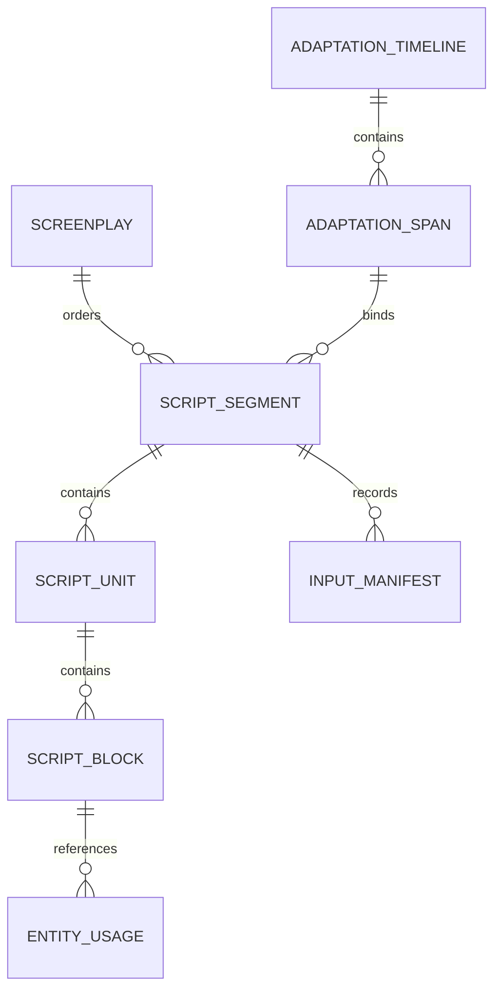

# 剧本与改编时间段数据结构设计

日期：2026-11-03  

当前用户补充：剧本时间线从改编时间线导入独立副本，剧本内调整不影响源改编；工作页为可各自折叠的四栏。本文关于同一改编时间线跨剧本共享span的早期设计不再作为当前合同，具体见分期计划4.2和10.1。
状态：早期背景设计；当前实现与验收结论见 SCREENPLAY_PHASE_PLAN.md。新增剧本独立表不改变原作 schema 10；本文早期对象字段与接口若有冲突，以分期计划及当前类型化API为准。

实现约束：不考虑任何版本兼容性，只实现当前目标结构和接口；不提供旧格式读取、迁移、旧客户端支持、兼容字段或兼容测试。现有业务数据均为可丢弃的开发测试数据，结构调整可直接清库、删除测试产物并重建，不要求备份或保留历史数据。工作区代码改动不属于可丢弃数据。

当前阶段以 [剧本功能开发计划与数据结构约定](SCREENPLAY_PHASE_PLAN.md) 为实施入口。该文件更新了剧本容器与集／幕的归属、场表与正文共享身份、逐场输入依据和批量写作合同；与本文冲突时以新约定为准。本文保留时间段解析、正文块和特殊画面的详细背景设计。

## 1 核心决定与范围

若干场组成一个剧本段，剧本段直接绑定一个改编时间段。改编时间段表示改编时间线上的一个连续范围，不是某一篇原文、单个事件、单个时间点，也不是成片中的秒数区间。

直接关系为：改编时间线 → 改编时间段 → 剧本段 → 场次与独立画面段 → 正文块。原作证据通过改编节点间接追溯。第一版不建立场次或对白到原作事件的强制逐条对应。

正文保持简洁：场头、描述、人物、对白及必要的字幕和声音；制作元数据通过属性面板读取。场次不是镜头，时间段不是幕，改编顺序不是原文阅读顺序或视频播放时间。

本文设计范围包括时间段、剧本及其绑定、编辑、变化检测、生成输入和持久化。视频生成、分镜和剪辑只定义引用边界，不在此实现。

## 2 当前基础与待新增机制

当前工作区的 `adaptation_operations.py` 已出现独立改编工作区、`sort_id` 排序、`suppressed` 屏蔽及改编修订号；`adaptation_views.py` 提供改编读取投影。这些是工作区代码现状，不代表已发布或已完成验收。

**改编时间段及剧本能力已按分期计划实现。** 本文后续保留早期设计背景；当前对象字段、操作和验收状态以 `SCREENPLAY_PHASE_PLAN.md` 及类型化接口为准。现有 `point_id` 和资产时间点仍不能充当时间段。

遵循现有 [数据模型](DATA_MODEL.md) 与 [接口合同](AGENT_API.md)：

- 原作 schema 10 继续只表达原作当前对象、证据和属性有效区间。
- 新业务由 `Operations` 统一开放给 UI、CLI、MCP 和当前统一对话，不直接由前端写库。
- 开发重置无需保留原文测试输入、既有报告、生成结果或历史任务记录；正常业务的原子性、并发检查及编辑范围规则仍须满足。本轮真实验收记录按实际请求保存，不以清库掩盖失败。
- 不新增人工接受队列，不将任务成功与局部已提交结果混为一谈。
- 本文的并发修订号不用于节点历史重放；任务输入档案不作为原作节点旧版本。

## 3 对象关系



| 对象 | 职责 | 基数约定 |
| --- | --- | --- |
| AdaptationTimeline | 标识一个改编工作区及其顺序、属性状态 | 一个工程第一版仅有一个当前改编工作区 |
| AdaptationSpan | 定义改编时间线上的连续范围 | 属于一个时间线；可被多份剧本复用 |
| Screenplay | 一部短片或一集的剧本容器 | 有序包含多个剧本段 |
| ScriptSegment | 针对一段改编内容编写的若干场 | 恰好绑定一个时间段 |
| ScriptUnit | 场次或独立画面段 | 恰好属于一个剧本段 |
| ScriptBlock | 动作、对白、字幕等正文内容 | 恰好属于一个单元 |
| StructureGroup | 幕、楔子、尾声、序列等组织信息 | 可跨多个剧本段组织连续单元 |
| InputManifest | 某次写作实际依据的输入清单 | 属于一个剧本段，不代替其当前范围绑定 |

同一时间段允许对应不同剧本的不同写法。同一剧本内，重复或重叠绑定返回提示，允许用于闪回、重复叙述等明确用途；不能把重叠一律当作错误。第一版不提供一个剧本段绑定多个不连续范围的形式，确有需要时建立多个剧本段。

## 4 改编时间段

### 4.1 字段

所有 ID 均为不含顺序含义的稳定字符串。示例使用易读 ID，实际可使用 UUID。

| 字段 | 类型 | 约束与说明 |
| --- | --- | --- |
| `id` | string | 时间段稳定身份 |
| `timeline_id` | string | 当前工程内稳定的改编工作区身份，拟新增；不使用文件绝对路径作身份 |
| `name` | string | 用户可改名，例如“赴约遇伏” |
| `start_node_id` | string | 包含的起始改编事件或动作 ID |
| `end_node_id` | string | 包含的结束改编事件或动作 ID |
| `boundary_mode` | enum | 第一版固定 `inclusive_anchors`，双端包含 |
| `suppression_policy` | enum | 第一版固定 `exclude_suppressed` |
| `revision` | integer | 时间段定义的并发版本；改名或改边界时递增 |
| `created_at / updated_at` | UTC timestamp | 元数据，不作为时间线排序依据 |

边界保存节点 ID，不保存 `sort_id` 数值、数组下标、屏幕行号或原文坐标。当前工作区即使节点 ID 与原作相同，也必须用 `timeline_id` 区分所属数据域。

### 4.2 规范时间轴与界面选区

第一版用改编工作区的事件、动作构成规范时间轴，按当前 `sort_id` 升序排列；人物、地点、物品和故事容器不直接作为范围成员。动作仅在已经存在时参与，创建时间段不触发动作提取。

界面选中场景、大事件或主要故事时，解析其有效事件／动作后代，再取最早和最晚的节点作为边界。此间所有事件／动作都是范围成员，不因其不属于所选容器而遗漏；如包含交错的其他容器内容，应返回诊断并在预览中显示。没有可解析后代时拒绝建立范围。

父事件和子动作可以同时作为结构化输入，但生成上下文须保留包含关系并只序列化各对象一次，不能把父事件概括和子动作当成两次独立发生。

搜索、类型过滤、树形折叠只是显示方式，不改变范围语义。选区在当前规范时间轴上连续，不能把过滤后相邻的两行误认为中间没有其他事件。

### 4.3 范围解析

对同一次只读事务中的改编快照执行：

1. 检查两个锚点存在、类型有效且属于指定时间线。
2. 检查起点排序不晚于终点；相同锚点合法，代表一个节点的范围。
3. 按排序取闭区间内全部事件／动作，得到 `member_node_ids`，包含被屏蔽成员。
4. 按现有改编活动状态合同过滤，得到 `effective_node_ids`。
5. 读取有效成员涉及的实体、属性有效区间和必要的上下文，保留各状态的适用位置。
6. 返回范围、有效内容、诊断和输入指纹。不得只取终点状态作为整段人物／道具状态。

解析返回值是只读派生信息，不重复写回原作或上层叙事节点。

```json
{
  "span_id": "span_01",
  "span_revision": 1,
  "adaptation_revision": 28,
  "status": "valid",
  "member_node_ids": ["E12", "E13", "E14", "E15"],
  "effective_node_ids": ["E12", "E14", "E15"],
  "suppressed_node_ids": ["E13"],
  "input_fingerprint": "sha256:<canonical-input-hash>",
  "diagnostics": []
}
```

### 4.4 后续编辑的确定行为

时间段采用“固定身份锚点、随当前排列解析”的范围。它不是创建时冻结的成员集合。冻结的是某次生成使用的输入档案，两者分开保存。

| 时间线变化 | 当前范围行为 | 对已有剧本的处理 |
| --- | --- | --- |
| 内部节点改内容、改属性或参与者 | 范围身份不变，输入变化 | 标记输入已变化，保留正文 |
| 内部插入节点 | 新节点自动进入当前范围 | 标记成员变化，不自动改写 |
| 内部节点移出／外部节点移入 | 按当前边界重新解析成员 | 标记成员变化 |
| 范围内节点重新排序 | 使用新顺序 | 标记顺序变化 |
| 屏蔽内部或边界节点 | 节点仍作范围定位，屏蔽内容不进入有效输入 | 标记有效成员变化 |
| 起止锚点互换次序 | `invalid`，诊断 `SPAN_REVERSED` | 保留正文；修复范围前不可生成 |
| 删除任一锚点 | `invalid`，诊断 `SPAN_ANCHOR_MISSING` | 不自动替换成相邻节点 |
| 两锚点存在但全部内容被屏蔽 | `empty` | 允许阅读旧正文，不允许生成新剧本 |
| 删除内部节点 | 当前范围不再包含该节点 | 标记成员变化 |
| 范围外无关节点发生变化 | 输入指纹不变 | 不标为过期 |
| 整段平移且内容、顺序、相关上下文均不变 | 输入指纹不变 | 不标为过期 |

移动边界节点可能大幅扩大或缩小范围，这是显式语义；操作结果应列出受影响时间段与成员增减。用户或 agent 可通过重新设置边界修正，无需人工审批队列。

范围诊断是派生状态。时间线编辑不能因为已有剧本绑定就被一概禁止；出现边界缺失时使用可解释的失效绑定，不保留重定向或节点旧对象。已有正文仍可导出，但导出结果须携带过期／失效提示，不能标为已同步。

## 5 剧本及剧本段

### 5.1 Screenplay

| 字段 | 类型 | 说明 |
| --- | --- | --- |
| `id` | string | 稳定身份 |
| `title` | string | 剧本名称 |
| `format` | enum | `short_film / feature / episode / other` |
| `language` | string | 默认 `zh-CN` |
| `series_id / episode_number` | nullable string | 可选系列信息；一集一份剧本 |
| `timeline_id` | string | 限定本剧本所有时间段的数据域 |
| `target_duration_seconds` | nullable number | 正数，目标时长 |
| `creative_brief` | object | 受众、风格、改编约束等 |
| `status` | enum | `draft / ready`，工作标记而非审批状态 |
| `revision` | integer | 第一版所有剧本文档编辑使用此聚合并发版本 |
| `created_at / updated_at` | UTC timestamp | 元数据 |

### 5.2 ScriptSegment

| 字段 | 类型 | 说明 |
| --- | --- | --- |
| `id` | string | 剧本段身份 |
| `screenplay_id` | string | 所属剧本 |
| `span_id` | string | 必填，唯一的直接内容范围绑定 |
| `position` | integer | 在剧本内的独立顺序；唯一，由程序在操作中维护 |
| `title` | string | 导航名称，不强制输出为正文标题 |
| `brief` | object | 本段目标、风格补充、必须保留／允许改写内容 |
| `target_duration_seconds` | nullable number | 本段目标时长 |
| `basis_manifest_id` | nullable string | 当前正文基于的输入档案；未建立依据时为空 |
| `enabled` | boolean | 是否纳入当前剧本输出 |

禁止把 `source_id`、`source_event_id`、单个 `point_id` 作为剧本段绑定字段。剧本段也不另外复制一份权威范围起止点。跨段调序只改变剧本呈现顺序，不修改改编时间线。

剧本段的同步状态读取时计算：`unbased / current / changed / invalid / empty`。不把工作状态 `ready` 与来源状态 `current` 混用。手动编辑正文不自动将来源标记为已同步。

生成一个段时可以创建多场。重新设置绑定后正文保留并标记依据变化。复制段需要新的 ID；删除段不默认删除其共享时间段。

## 6 正文单元和内容块

### 6.1 ScriptUnit 公共字段

| 字段 | 类型 | 说明 |
| --- | --- | --- |
| `id` | string | 稳定身份，未来镜头引用此 ID |
| `segment_id` | string | 所属剧本段 |
| `position` | integer | 段内唯一排序 |
| `kind` | enum | `scene / screen_segment` |
| `label` | nullable string | 导航说明 |
| `enabled` | boolean | 是否纳入输出 |
| `estimated_duration` | nullable object | `seconds` 与 `basis=author/model/animatic`；不是成片实际时长 |
| `production_notes` | string | 制作备注 |

第一版场次完整属于一个剧本段，不跨段共享。若合并不同段的场次，必须同时明确归属与范围调整；不隐式把两段绑定并成不连续集合。

### 6.2 Scene 专有字段

| 字段 | 类型 | 说明 |
| --- | --- | --- |
| `scene_number` | nullable string | 显示场号，如 `12A`；不作身份，重新编号是显式操作 |
| `setting` | object | `interior_exterior`、`location_id`、`location_text`、`time_label` |
| `story_time` | nullable object | 故事日、日期或与另一场的时间关系；允许未指定 |
| `narrative_mode` | enum | `normal / flashback / dream / imagined` |
| `dramatic_notes` | object | 可选目标、冲突、转折、结果 |
| `continuity_requirements` | array | 明确的服装、伤势、道具持有、天气等制作要求 |

`interior_exterior` 为 `INT / EXT / INT_EXT / UNSPECIFIED`。草稿允许只填地点文字；已有地点实体时优先引用改编地点 ID。地点文字是剧本表达，不反向重命名实体。

这些场次不新增到原作 `scene/S` 节点树。场次中的新对白、新动作属于剧本内容，不自动作为原作事实或改编时间线事件入库。

### 6.3 ScreenSegment 专有字段

`presentation` 为 `title_card / black_screen / credits / other`，不要求内外景或地点。例如黑底片名、黑屏中的电话声。叠加在某场行动画面上的字幕仍放在该场，不另造场次。

### 6.4 ScriptBlock

每块含 `id`、`unit_id`、`position`、`type` 和与类型匹配的 `payload`；不接受多个互相冲突的类型字段。

| type | payload 字段 | 表达 |
| --- | --- | --- |
| `action` | `text` | 环境、可见行为、表演描述 |
| `dialogue` | `speaker_id`、`speaker_label`、`text`、`delivery`、`parenthetical`、可选 `simultaneous_group_id` | 人物台词 |
| `screen_text` | `text`、`presentation=overlay/card` | 时间字幕、片名等 |
| `sound` | `text`、`category=effect/music/other`、可选 `entity_id` | 独立声音要求 |
| `transition` | `kind`、可选 `text` | 淡入、淡出、切黑等 |

`delivery` 使用 `on_screen / off_screen / voice_over / inner_voice`。草稿允许 `speaker_id=null` 且填写非空 `speaker_label`，但标记实体未绑定；有 ID 时验证为改编人物或允许发声的群体，显示名可有局部剧本表达。对白标签不自动创建原作人物。

连续对话使用多个对白块。表演提示属于对应对白块。非必要的景别、机位、运镜放入后续镜头对象，不塞进全部动作块。

正文块不必关联任何单个时间点。可选制作实体引用使用 `EntityUsage(block_id, adaptation_entity_id, role)`；`role` 为 `present / speaker / mentioned / used / visible`。人物被提及不算实际出场。场级清单由块引用和明确连续性要求派生，不重复写回原作上层。

## 7 幕与特殊组织

`StructureGroup` 含 `id`、`screenplay_id`、`kind`、`title`、`start_unit_id`、`end_unit_id`；`kind` 为 `act / prologue / epilogue / sequence / montage / intercut`。

分组只组织连续单元，允许嵌套但不允许交叉重叠；端点必须存在且先后有效。第一版只作用于单元级，不跨单元内部切块。修改造成非法分组时，显式更新／移除分组或返回诊断，不自动改其含义。

楔子可包含多场并跨多个剧本段；片名是实际正文块。幕不参与原作层级校验，也不承担改编时间段的身份。`intercut` 表达写作意图，具体切换位置由分镜／剪辑定义。

## 8 生成输入与变化检测

### 8.1 InputManifest

| 字段 | 说明 |
| --- | --- |
| `id / segment_id` | 本次写作依据的身份及所属段 |
| `span_id / span_revision` | 当时使用的范围定义 |
| `adaptation_revision` | 读取快照的改编版本 |
| `member_node_ids / effective_node_ids` | 当时解析的有序成员与有效成员 |
| `input_fingerprint` | 实际目标输入的规范化哈希 |
| `context_fingerprint` | 附加前后文、已有剧本及创作要求的哈希 |
| `dependency_refs` | 实际读取的实体、属性、前后文及其摘要 |
| `task_id` | 关联统一对话任务，可为空（手工建立依据） |
| `input_artifact_ref` | 本次任务输入档案位置，手工依据可为空 |
| `created_at` | 建立时间 |

哈希版本须固定，例如 `fingerprint_version=1`：UTF-8、稳定键顺序、数组保持业务顺序，不包括更新时间、无关全局 revision、纯存储 `sort_id` 数值。目标输入包含有效节点正文、相关结构、身份、屏蔽信息、顺序及相关属性区间。更改任何实际送入模型的上下文都必须反映到输入或上下文指纹。

快照指完整的任务输入材料，不是重新实现节点历史库。只保存 manifest 不足以复现实际提示；真实模型任务仍须保存提示版本、原始输入／响应、usage、终止原因、诊断与提交动作，并且不含密钥。

### 8.2 前后文与状态

目标只来自绑定范围。额外上下文可以包含前后事件、前后剧本段和本段涉及人物／物品状态，且必须标明“参考上下文”。不能因参考而扩大本次改编范围。

范围内发生道具换手、伤势变化等时，按各事件位置读取改编属性有效区间，不以范围终点的资产或属性覆盖全段。重排造成状态矛盾时返回诊断，不能擅自修改世界事实或生成伪造的依据。

### 8.3 写作提交

在当前统一对话和常驻会话中完成读取、写作、校验与提交，不引入专用分轮运行时。

提交同时带 `expected_screenplay_revision`、`expected_span_revision`、`input_fingerprint`、`context_fingerprint`。程序在同一事务中重新解析并比较；不只比较全局改编 revision，以避免无关改动导致失败。

输入或目标剧本变化时拒绝该次覆盖，保存任务输出及冲突诊断，不能自动重试真实请求。通过校验时原子写入场次、块与依据 manifest。校验失败不写入半场内容；agent 可以在同一任务内依据诊断修正。

用户直接修改正文不自动更新依据。`mark_script_segment_basis_current` 可由用户或 agent 显式声明已核对当前范围，记录理由与新 manifest，不要求人工审核；没有实际核对不能仅为消除提示而调用。

## 9 完整绑定示例

以下对象是 API 交换示例，关系表中分别存储。示例人物和地点属于改编工作区，不是剧本与原作的直接绑定。

```json
{
  "span": {
    "id": "span_01",
    "timeline_id": "adaptation_main",
    "name": "赴约遇伏",
    "start_node_id": "E12",
    "end_node_id": "E15",
    "boundary_mode": "inclusive_anchors",
    "suppression_policy": "exclude_suppressed",
    "revision": 1
  },
  "screenplay": {
    "id": "screenplay_01",
    "title": "密信",
    "format": "short_film",
    "language": "zh-CN",
    "timeline_id": "adaptation_main",
    "revision": 1,
    "status": "draft"
  },
  "segment": {
    "id": "segment_01",
    "screenplay_id": "screenplay_01",
    "span_id": "span_01",
    "position": 1024,
    "title": "赴约遇伏",
    "brief": {"goal": "从期待赴约转向发现陷阱"},
    "basis_manifest_id": null,
    "enabled": true
  },
  "units": [
    {
      "id": "unit_01",
      "segment_id": "segment_01",
      "position": 1024,
      "kind": "scene",
      "scene_number": "1",
      "enabled": true,
      "setting": {
        "interior_exterior": "INT",
        "location_id": "W1",
        "location_text": "住处",
        "time_label": "夜"
      }
    },
    {
      "id": "unit_02",
      "segment_id": "segment_01",
      "position": 2048,
      "kind": "scene",
      "scene_number": "2",
      "enabled": true,
      "setting": {
        "interior_exterior": "INT",
        "location_id": "W2",
        "location_text": "茶馆",
        "time_label": "次日晨"
      }
    },
    {
      "id": "unit_03",
      "segment_id": "segment_01",
      "position": 3072,
      "kind": "screen_segment",
      "presentation": "title_card",
      "enabled": true
    }
  ],
  "blocks": [
    {
      "id": "block_01", "unit_id": "unit_01", "position": 1024,
      "type": "action", "payload": {"text": "甲展开密信，目光停在最后一行。"}
    },
    {
      "id": "block_02", "unit_id": "unit_02", "position": 1024,
      "type": "dialogue",
      "payload": {
        "speaker_id": "P1", "speaker_label": "甲", "text": "账本在哪里？",
        "delivery": "on_screen", "parenthetical": "压低声音"
      }
    },
    {
      "id": "block_03", "unit_id": "unit_02", "position": 2048,
      "type": "action", "payload": {"text": "身后的门缓缓合上。"}
    },
    {
      "id": "block_04", "unit_id": "unit_03", "position": 1024,
      "type": "screen_text", "payload": {"text": "密信", "presentation": "card"}
    }
  ]
}
```

该例中两场戏与片名共同属于一个剧本段，整段绑定 `span_01`。两场不分别绑定 E12 或 E15；范围边界仅定义该段的输入范围。

## 10 持久化与 Operations 草案

### 10.1 存储

建议在现有工程数据库中以独立表保存新业务，便于改编快照检查与剧本提交共享同一个 SQLite 事务。与原作 `objects/property_records` 逻辑隔离，不把剧本场次作为原作节点写入。

拟新增表：`adaptation_spans`、`screenplays`、`script_segments`、`script_units`、`script_blocks`、`script_structure_groups`、`script_entity_usages`、`script_input_manifests`。所属关系与排序使用普通列及索引，类型专有内容使用受验证 JSON。

- 所属关系使用外键；段、单元、块分别在父级内约束排序唯一。
- 时间线节点当前存于工作区文档，锚点不能伪装成 SQL 外键，由 Operations 验证并报告失效。
- 删除段／单元必须明确处理子项和未来分镜引用；不静默级联删除已有镜头或媒体文件。
- 只存当前剧本对象；输入档案与审计是任务记录，不承担撤销重放。
- 直接按当前目标结构初始化业务表，不引入模块存储版本协商、迁移或发布兼容策略。只读操作不建表、不修改数据。
- 开发结构调整允许删除和重建测试素材、数据库及历史产物，不设计备份或迁移。正常导出按指定目标写入。

### 10.2 拟新增操作

以下名称均为接口设计，当前不存在这些实现。

| 操作 | 行为 |
| --- | --- |
| `preview_adaptation_span` | 从选区或端点只读解析范围、成员、相关状态和诊断 |
| `create_adaptation_span` | 校验快照后创建时间段，不生成剧本 |
| `update_adaptation_span` | 改名或重设边界，返回受影响剧本段 |
| `read_adaptation_span` | 返回定义与当前解析结果 |
| `create_screenplay` | 创建剧本容器 |
| `create_script_segment` | 将一个时间段绑定为一个新剧本段 |
| `read_script_segment_context` | 返回目标范围、参考上下文、已有正文、指纹及诊断 |
| `apply_screenplay_changes` | 原子新增／修改／调序／屏蔽／删除段、单元与块 |
| `submit_script_segment` | 同一 agent 任务提交正文，校验后自动入库 |
| `mark_script_segment_basis_current` | 显式记录已核对当前输入及理由 |
| `check_screenplay` | 只读检查引用、排序、范围和来源变化 |
| `export_screenplay` | 按独立剧本顺序输出正文，附诊断摘要 |

所有写操作要求相应预期修订号和 `reason`。创建时间段时使用预期改编快照版本；修改剧本时使用剧本聚合版本。`preview` 是独立试查能力，不是强制的提交前步骤。

### 10.3 校验与诊断

结构错误原子拒绝：跨工程／时间线绑定、重复 ID、非法正文 payload、无效所属关系、重复顺序、提交指纹不符、越权扩大目标段或删除未处理引用。

草稿提示不一概阻断编辑：未指定地点／时间、未绑定对白人物、估计时长超目标、范围重叠、人物／道具连续性存疑。生成或导出需要的约束按用途检查；确定性校验不能冒充戏剧质量或语义忠实度判断。

范围失效允许保留和编辑旧正文，但禁止以失效范围发起生成。导出旧稿须显示诊断。生成任务取消标记 `cancelled`，保留已成功的原子写入和当前常驻会话；本设计不新增任务总时限、固定轮次或自动重试。

## 11 第一版实现顺序与验收范围

1. 时间段定义与纯读取解析，验证界面选区、边界与屏蔽规则。
2. 剧本、剧本段、场次、独立画面段及五类正文块，支持手工编辑和连续阅读。
3. 范围变化检测、依赖指纹与统一对话中的选区写作提交。
4. 幕／楔子分组与正文导出；分镜、生成素材和剪辑对接后续独立设计。

必要回归用例：

- 选择多个连续改编事件后生成两场；只有剧本段绑定范围，场次没有原作绑定要求。
- 原文来源不连续但改编顺序连续，范围合法；界面过滤不改变隐藏成员的范围归属。
- 单节点范围、屏蔽端点、全部屏蔽、端点删除／倒置、内部移入移出行为符合第4节。
- 范围内部属性换手按位置生效；不把终点持有者套用全段。
- 无关改动不标记过期；实际使用的上下文变化可检出；手工改对白不伪造同步状态。
- 同一范围可用于多个剧本；重叠给出诊断；改编调序不自动重排剧本或改写正文。
- 模型提交期间正文被用户修改时不覆盖；非法提交无局部写入；取消保留已完成提交。
- 楔子包含多场；独立片名没有虚构地点；画面叠字留在场内；块与未来镜头保持不同身份。
- 从空库建立当前结构；正常只读操作不初始化，引用删除有确定诊断；不要求旧数据保留或兼容。

原设计阶段仅交付文档；当前已按分期计划完成开发及单个最小时间段的隔离真实功能闭环。原始输出、同任务纠错、usage和实际入库动作均已记录；本轮token观察预算超额单独标为未通过，没有新增真实请求重试，详见分期计划第10节。
